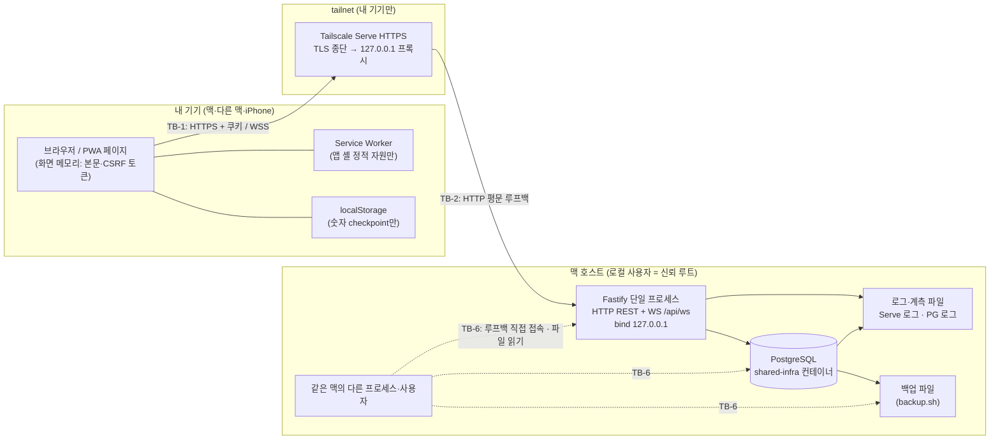

# 위협 모델 — 개인 전용 웹 메신저 MVP (W-03)

- 상태: 초안 v0.1 (Security, 개발설계서 W-03 산출물) / 작성일: 2026-11-07
- 개정 v0.2 (2026-11-08): ADR-001(Hermes 봇 연동, D-1~D-7 ★ 채택) 반영 — 자산 AS-09–12, 신뢰 경계 TB-8·TB-9, §4-9 STRIDE 행, §0 결론 5. 표기 `ADR:§` = `docs/decisions/ADR-001-hermes-agent-integration.md`. 새 행의 잔여 위험 등급은 구현 전·미검증 값입니다.
- 범위: 단계 P1(MVP) 설계 문서 기반 분석. 코드·DB·`.env`·Tailscale 설정·실서비스는 조회하지 않았고 스캔·PoC도 하지 않았습니다.
- 정본: TRD R3.1(`docs/03-trd/TRD.md`, 아래 `T:행`), 개발설계서 R3.1(`docs/04-dev-design/DEV_DESIGN.md`, `DD:행`), PRD v1.2(`docs/02-prd/PRD.md`, `P:행`), 화면 상태 명세(`docs/07-ui-spec/UI_STATES.md`, `U:행`), 디자인 레퍼런스(`docs/05-design-ref/DESIGN_REFERENCE.md`, `D:행`), `CLEANROOM.md`.
- 이 문서는 값(수치·정책)을 새로 정하지 않습니다. 정본에 값이 없으면 "결정 필요"로 남기고 선택지만 적습니다.
- 사용자 대상 반환처: Jarvis. 이후 W-06–W-11 구현 레인과 W-15 Security 리뷰가 이 문서의 §7을 보안 수용 기준으로 씁니다.

## 0. 결론

1. **잔여 High 0건.** 조건: 정본의 기존 통제와 6-2·6-3의 기존 테스트가 구현·통과한다는 전제입니다(신규 후보 미구현 상태 기준). 잔여 Medium은 13건이고 §5 신규 후보는 이 Medium을 낮추기 위한 것입니다. Medium은 대부분 **정본에 값이나 통제가 없는 곳**에서 나옵니다(§6).
2. 가장 먼저 정해야 할 것 3가지:
   - **로그인 제한의 "출처" 정의.** Serve가 127.0.0.1로 프록시하므로 앱이 보는 출처 IP는 모두 같습니다(T:137 vs T:26, T:158). 지금 문구대로 구현하면 출처별 제한이 전역 1개로 줄어듭니다.
   - **초대 토큰 수명 값과 폐기 경로.** `expires_at`·`revoked_at` 컬럼은 있으나(T:48) 수명 값과 폐기 route가 없습니다(T:80).
   - **API 응답의 HTTP 캐시 금지.** TRD는 Cache API·IndexedDB·localStorage만 막습니다(T:160). 브라우저 HTTP 디스크 캐시는 통제 밖입니다.
3. 구조 문제 1건: 6-3에만 있는 테스트 2개(`secret-storage.int.test.ts`, `frame-limit.int.test.ts`)는 `check:fr-coverage` 입력(DD:196)에 없어서, G1에서 빠져도 게이트가 통과합니다(§5 NC-01).
4. 6-3 누락 후보 27건(§5), 정본 간 불일치·확인 필요 16건(§6)을 Jarvis에 반환합니다.
5. **ADR-001 봇·첨부·푸시(v0.2, §4-9).** 잔여 Medium 신규 5건(TM-BOT-01·04·05·07, TM-ATT-03). 그중 **TM-BOT-04(다른 멤버 메시지 → Jarvis 지시)**가 가장 중요하며, 서버 멤버십 상한 + 어댑터 owner allowlist 이중 통제를 출시 게이트로 둡니다. 네트워크 자세 변화: Web Push 도입 시 서버가 **처음으로 outbound 인터넷 요청**을 합니다(TB-9). 인바운드 노출은 변하지 않습니다(봇 리스너는 별도 루프백 포트, Serve 대상 아님).

## 1. 배포 전제 (확정, 브리프)

- 개인 전용. 실제 사용자 1명(owner) + 합성 계정(A/B/C). 실제 타인 초대는 별도 승인(P:181 ⚖️-2).
- 맥 1대. Fastify 단일 프로세스가 `127.0.0.1:<port>`에만 바인드(T:158, DD:43).
- Tailscale Serve HTTPS로 내 tailnet 기기만 접근. Funnel·라우터 포워딩·LAN 바인드·`0.0.0.0` 금지(T:158, DD:355).
- PostgreSQL은 shared-infra 컨테이너. **호스트 포트 바인드 범위(루프백 한정 여부)는 확인 필요**(이 문서는 조회하지 않음).
- Redis 없음. WebSocket은 best-effort 알림 경로이고 DB가 단일 원장(T:17, T:126).

## 2. 자산 목록과 C·I·A 요구

C=기밀성, I=무결성, A=가용성. 등급은 H/M/L.

| ID | 자산 | 저장 위치(정본) | C | I | A | 요구 근거 |
|---|---|---|---|---|---|---|
| AS-01 | 세션 토큰 | 브라우저 쿠키(원문), `sessions.token_hash`(해시) — T:49, T:132 | H | H | M | 원문은 쿠키에만. 탈취 = 계정 사칭. 폐기·비활성화가 5초 안에 HTTP·WS에 반영돼야 함(T:132, T:146) |
| AS-02 | 비밀번호 해시 | `users.password_hash` — T:46, T:131 | H | H | L | 원문 미저장(T:144). 해시 알고리즘·파라미터는 착수 시 고정(T:131, 미정) |
| AS-03 | 초대 토큰 | 링크 프래그먼트(원문, 1회 표시), `invites.token_hash` — T:48, D:200 | H | H | L | 1회 사용·만료·폐기. 원문은 URL 경로·로그·Web Storage에 두지 않음(D:19, U:260) |
| AS-04 | 메시지 본문(멘션 포함) | `messages.body`, 화면 메모리 — T:52, T:160 | H | H | M | 참여자에게만(T:135). 기기 지속 저장 금지(T:150). 삭제 후 재노출 금지(T:68) |
| AS-05 | 읽음 상태 | `conversation_read_state`·`thread_read_state` — T:55–56 | M | M | L | 본인 기기에만 팬아웃(DD:96). 단조 증가·범위 검사(T:70) |
| AS-06 | sync checkpoint | 기기 localStorage(숫자 1개) — T:103, DD:87 | L | M | L | 숫자 외 저장 금지, 로그아웃 시 삭제(DD:189). 값이 틀리면 누락이 생김(무결성) |
| AS-07 | 백업 | shared-infra `backup.sh` 산출물 — T:181 | H | H | M | AS-01–05 전부의 사본 + 삭제 전 본문. 보존·삭제·RPO/RTO 미정(T:181, P:182) |
| AS-08 | 로그·계측 | 앱/HTTP/WS 로그, Serve 로그, PG 서버 로그, 로컬 계측 7일 — T:139, P:160–170 | M | L | L | 본문·자격 증명·토큰·식별자·IP·UA 0건(T:139, P:115) |
| AS-09 | 봇 토큰 | 원문: Hermes 쪽 설정(`~/.hermes/.env` 계열, 600) 1곳, DB `bot_tokens.token_hash`(SHA-256) — ADR:§3 | H | H | M | 탈취 = Jarvis 사칭(owner DM에 지시처럼 보이는 메시지 게시). 원문은 1회 표시, 로그·URL 금지 |
| AS-10 | 첨부 파일 바이트 | `attachment_blobs`(PG bytea, ADR:§3-g, D-4 ★) | H | H | L | 대화 참여자에게만. 지속 캐시 금지(T:150 확장), 보존 기한 후 삭제 |
| AS-11 | Web Push 구독·VAPID 개인키 | `push_subscriptions`(endpoint·키), VAPID 개인키는 서버 비밀 파일(600) | M | H | L | endpoint는 기기 식별자 성격. 개인키 유출 = 임의 알림 발송 |
| AS-12 | Hermes 세션 지시 권한 | owner의 DM 메시지가 Hermes 도구 실행으로 이어지는 경로 | H | H | M | 맥 로컬 권한으로 명령 실행 가능한 에이전트 → **무결성 최상위** |

보조 자산: CSRF 토큰(`GET /api/me` 응답, T:133, C=M), `.env`·`.env.test` DB 자격 증명(DD:401, C=H), 로컬 owner 생성 명령(DD:45, I=H).

## 3. 신뢰 경계

| 경계 | 사이 | 넘는 데이터 | 이 경계의 핵심 통제(정본) |
|---|---|---|---|
| TB-1 | 브라우저·PWA SW ↔ tailnet·Serve | 쿠키, CSRF 헤더, 본문, WS 프레임 | Serve HTTPS(T:158), 쿠키 속성(T:132), 앱 셸만 캐시(T:160) |
| TB-2 | Serve ↔ Fastify HTTP·WS | 위와 같음(평문 루프백), 프록시 헤더 | 루프백 바인드(T:149), 앱 인증이 tailnet 인증과 독립(T:17, T:131), Origin·CSRF(T:133), WS handshake 검사(T:109) |
| TB-3 | Fastify 내부: 라우트 → 서비스 → 저장소 | 사용자 ID, 대화 ID | `access` 메타 필수 + `assertAccess` 단일 경계(DD:82, DD:98–111) |
| TB-4 | Fastify ↔ PostgreSQL | SQL, 해시, 본문 | 단일 트랜잭션·FK 제약(T:64–66), 테스트 DB 안전장치(DD:202–205) |
| TB-5 | 앱·DB ↔ 로그·백업 | 로그 줄, 덤프 | 로거 허용 목록(DD:86), 백업 무수정 사용·격리 복원(T:152, T:181) |
| TB-6 | 맥 로컬 사용자·프로세스 ↔ 앱·DB·파일 | 루프백 소켓, 파일 | 앱 인증(T:131), `.env.test` 600(DD:401). **그 밖의 로컬 통제는 없음 — 맥 사용자 계정이 신뢰 루트** |
| TB-7 | 의존성 레지스트리·CI ↔ 저장소·맥 | 패키지, 빌드 스크립트 | `--frozen-lockfile`·`pnpm audit --prod`(DD:167, DD:178), `onlyBuiltDependencies: esbuild`(`pnpm-workspace.yaml`) |
| TB-8 | Hermes 게이트웨이(어댑터) ↔ ohmyslack 봇 리스너 | Bearer 봇 토큰, 메시지 본문, 첨부, WS 이벤트 | **별도 루프백 포트**(Serve 대상 아님), Bearer 전용(쿠키 무시), 봇 전용 라우트 prefix, 봇 계정의 멤버십 상한(owner DM) — ADR:§3·§6 |
| TB-9 | ohmyslack 서버 → Web Push 서비스(Apple 등) | 암호화 push payload, VAPID JWT | outbound HTTPS만, payload에 본문 미포함(★), endpoint 호스트 허용목록 — ADR:§3-i |

## 4. STRIDE 위협 표

- **잔여 위험**은 "기존 통제가 정본대로 구현됐다"고 가정한 뒤 남는 위험입니다. H=통제를 완전히 우회해 실제 피해(계정 탈취·참여자 밖 본문 노출), M=통제가 약하거나 정본에 없음, L=경계 위반 영향이 작거나 전제가 드묾.
- **검증 열 표기:** `[기존 6-2: …]`·`[기존 6-3: …]`는 개발설계서에 이미 있는 테스트, `[신규 NC-nn]`은 §5의 새 후보, `[수용]`은 테스트 대신 위험 수용을 제안하는 행입니다.
- 통제 열의 "통제 없음"은 정본 어디에도 해당 통제가 없다는 뜻입니다.

### 4-1. TB-1 브라우저·PWA·SW

| ID | S/T/R/I/D/E | 위협 | 기존 통제(정본) | 잔여 | 검증 |
|---|---|---|---|---|---|
| TM-WEB-01 | I | 본문·인증 응답이 SW Cache Storage·IndexedDB·Web Storage에 남아 로그아웃 뒤나 기기 분실 시 읽힘 | T:150 TR-SEC-08, T:160, DD:87 B7(예외 2파일), DD:187–191 | L | [기존 6-3: TR-SEC-08 → FR-CLIENT-04 + `check:no-persist-cache`] |
| TM-WEB-02 | I | SW를 우회한 `/api/**` 응답이 **브라우저 HTTP 디스크 캐시**에 저장됨(본문 목록·`/api/me`의 CSRF 토큰) | **통제 없음** — T:160은 Cache API·IndexedDB·localStorage만, `Cache-Control` 정의 없음. P:104 "API·WS 캐시 제외"가 의도는 포함 | M | [신규 NC-02] |
| TM-WEB-03 | I | 로그아웃·401 뒤 뒤로·앞으로·bfcache 복원으로 본문이 다시 보임 | P:104, U:65·U:444 C9(메모리 비움 → `/login`) | L | [기존 6-2: FR-CLIENT-04 지정 + `QA-FR-CLIENT-04`] |
| TM-WEB-04 | T | checkpoint가 계정에 묶이지 않아, 401(만료·비활성) 뒤 다른 계정이 같은 기기에서 로그인하면 앞 계정의 커서로 catch-up을 건너뜀(누락) | DD:189 "로그아웃 때 지움". **401 경로·계정 결속은 통제 없음**(U:444는 "메모리 비움"만) | L | [신규 NC-14] |
| TM-WEB-05 | E | 메시지 본문의 HTML·스크립트·위험 스킴 링크 실행(저장형 XSS) | T:136, T:147 TR-SEC-05, D:311(`rel="noopener noreferrer"`), U:186 | L | [기존 6-3: TR-SEC-05 → FR-MSG-01] |
| TM-WEB-06 | E | **본문 밖** 사용자 입력(채널 이름, 초대 수락 때 넣는 표시 이름, 멘션 칩 `@이름`, DM 상대 이름)의 XSS | T:136은 "메시지"만 규정. 이름류 렌더 규칙은 **통제 없음**(프레임워크 기본 이스케이프에 기댐) | M | [신규 NC-11] |
| TM-WEB-07 | E/T | XSS 1건이 세션 권한 전체로 번짐. 다른 출처가 앱을 iframe에 넣어 클릭을 유도함 | **통제 없음** — CSP·`frame-ancestors`·`nosniff`가 TRD에 없음. `Referrer-Policy`는 디자인 문서에만(D:200) | L | [신규 NC-13] |
| TM-WEB-08 | S | 로그인 뒤 `?next=` 값으로 외부 사이트로 이동(열린 리다이렉트 → 피싱) | D:199·U:256 "경로만" | L | [신규 NC-12] |
| TM-WEB-09 | I | 초대 토큰이 URL 경로·Referer·서버/Serve 로그·방문 기록에 남음 | D:19·D:200(프래그먼트 `#t=`, 읽은 즉시 `replaceState`, `no-referrer`), U:260, U:517(메모리 재시도) | L | [기존 6-3: TR-SEC-02 `secret-storage`(DB·로그)] + [신규 NC-15] |
| TM-WEB-10 | I | CSRF 토큰·초대 토큰이 Web Storage·DOM 속성에 저장됨 | T:134(인증 token은 URL·localStorage·로그 금지), DD:87 B7 lint | L | [기존 6-2: FR-CLIENT-04] + [신규 NC-15] |
| TM-WEB-11 | T | 이전 빌드의 SW가 패치 전 앱 셸을 계속 제공함(업데이트 정책 없음) | T:160은 캐시 범위만 정함. 갱신·활성화 정책은 **통제 없음** | L | [신규 NC-24] |

### 4-2. TB-1·TB-2 tailnet·Serve·바인드

| ID | S/T/R/I/D/E | 위협 | 기존 통제(정본) | 잔여 | 검증 |
|---|---|---|---|---|---|
| TM-NET-01 | I/E | Funnel이 켜지거나 라우터 포워딩으로 앱이 공인 인터넷에 노출됨 | T:149 TR-SEC-07, T:158, DD:355, DD:152 W-12 런북 | L | [기존 6-3: TR-SEC-07 → FR-OPS-01 + `QA-FR-OPS-01`(Funnel 꺼짐)] |
| TM-NET-02 | E | 환경 변수·설정 실수로 앱이 `0.0.0.0`·LAN 주소에 바인드됨 | T:158 금지, DD:43. 단 FR-OPS-01 지정 테스트는 **기본값**만 확인(DD:281) | L | [기존 6-2: FR-OPS-01] + [신규 NC-05] |
| TM-NET-03 | S | tailnet 접근을 앱 인증으로 착각함. Serve가 붙이는 신원 헤더나 `X-Forwarded-For`를 권한 판정에 씀 | T:17·T:131(앱 인증은 tailnet과 독립), T:74(권한은 서버 세션만), P:113 | L | [기존 6-2: FR-OPS-01 "tailnet 접근만으로 로그인 생략 불가"] + [신규 NC-06] |
| TM-NET-04 | S/I | tailnet 안의 다른 노드(공유 노드, 향후 승인된 타인 기기)가 Serve 주소에 닿음 | 앱 인증(T:131), Serve hostname은 비밀 아님(T:158). tailnet ACL은 정본 밖 → **확인 필요** | L | [기존 6-2: `QA-FR-OPS-01`] + 확인 필요(§6 #12) |
| TM-NET-05 | S/T | 맥에서 연 다른 출처 페이지가 루프백 앱 포트로 요청(DNS 재바인딩 포함) | 상태 변경은 정확한 Origin + CSRF(T:133), 쿠키는 Serve 호스트 전용(T:132)이라 루프백 요청에 실리지 않음. **Host 헤더 허용 목록은 통제 없음** | L | [기존 6-3: TR-SEC-03 → FR-AUTH-06] + [신규 NC-04] |
| TM-NET-06 | D | 맥 잠자기·전원·tailnet 단절로 전체 불가 | T:175 NFR-08(공용 SLA 없음), U:429 끊김 표시 | L | [수용] — 가용성 보장 없음이 정본 |

### 4-3. TB-2·TB-3 Fastify HTTP (인증·세션·CSRF·권한)

| ID | S/T/R/I/D/E | 위협 | 기존 통제(정본) | 잔여 | 검증 |
|---|---|---|---|---|---|
| TM-HTTP-01 | S/I | 세션 토큰 추측·DB 유출로 세션 사칭 | 무작위 토큰, DB엔 해시만(T:132, T:144) | L | [기존 6-3: TR-SEC-02 `secret-storage.int.test.ts`] |
| TM-HTTP-02 | S | 세션 고정: 로그인 전에 심어 둔 쿠키 값이 로그인 뒤에도 유효 | **통제 없음**(로그인 시 새 토큰 발급 규칙이 명시되지 않음) | L | [신규 NC-07] |
| TM-HTTP-03 | S/I | 쿠키 속성 오설정: 개발용 `Secure` 해제가 운영 빌드에 섞임, `Domain` 지정으로 다른 호스트에 전송됨 | T:132(`HttpOnly`·`Secure`·`SameSite=Lax`·`Path=/`·host-only), DD:339 R-05(환경별 분리) | M | [신규 NC-08] — 쿠키 속성은 6-2·6-3 어느 테스트 이름에도 없음 |
| TM-HTTP-04 | T | CSRF: 다른 출처가 로그인된 브라우저로 상태 변경 요청 | T:133(세션 결속 `X-CSRF-Token` + 정확한 Origin, GET/HEAD 부작용 금지), T:145 TR-SEC-03 | L | [기존 6-3: TR-SEC-03 → FR-AUTH-06] + [신규 NC-03](Origin 없음·`null`·포트 차이 경계) |
| TM-HTTP-05 | S | 로그인 무차별 대입. Serve 뒤에서는 출처 IP가 전부 127.0.0.1이라 **출처별 제한이 전역 1개로 퇴화**하거나, 프록시 헤더를 믿으면 위조 가능 | T:137(계정·출처 IP별 5회/15분), P:59. 출처 정의는 **통제 없음** | M | [기존 6-2: FR-AUTH-06] + [신규 NC-18](결정 후) |
| TM-HTTP-06 | D | 계정 제한을 일부러 채워 owner를 15분 잠금 | T:137(차단 후 복구 조건). tailnet 기기만 닿음 | L | [기존 6-2: FR-AUTH-06] |
| TM-HTTP-07 | I | 계정 열거: 로그인 오류 문구·응답 시간, 초대 수락의 "이미 있는 이메일" 응답 | T:137(로그인 동일 오류), D:322(구체 원인 미노출). 응답 시간·초대 수락 경로는 **통제 없음** | L | [신규 NC-17], [신규 NC-20] |
| TM-HTTP-08 | S/E | 초대 링크 유출 시 오래 유효함, 발급자가 회수할 방법이 없음, 수락 시도에 제한 없음 | T:48(`expires_at`·`revoked_at`·`token_hash`), T:80(원자적 1회 교환), P:54. **수명 값·폐기 route·수락 시도 제한은 통제 없음** | M | [기존 6-2: FR-AUTH-01(만료·사용·폐기·동시 수락)] + [신규 NC-16](결정 후) |
| TM-HTTP-09 | E | 초대 수락이나 원격 경로로 owner 계정이 생김 | DD:104(`invites/accept`는 member만), T:130, DD:292 BOOT-01 | L | [기존 6-2: FR-AUTH-01, BOOT-01] |
| TM-HTTP-10 | E/I | IDOR: 비참여자가 대화 ID·메시지 ID·root ID로 목록·이력·답글·snapshot·read-state·쓰기 접근, 존재 여부 추론 | DD:82 B2, DD:98–111 2-4 매트릭스(전체 라우트 수집), T:105(404 은폐), T:135, T:143 TR-SEC-01 | L | [기존 6-3: TR-SEC-01 → FR-CONV-04 접근 매트릭스] |
| TM-HTTP-11 | E | 일반 멤버가 초대·비활성화·채널 생성 호출 | T:80·T:82·T:85, DD:106 | L | [기존 6-2: FR-AUTH-05] |
| TM-HTTP-12 | T | 참여 비작성자의 타인 메시지 수정·삭제 | T:92–93, T:105(403) | L | [기존 6-2: FR-MSG-05] |
| TM-HTTP-13 | T/I | `thread_root_id`·read-state에 다른 대화의 ID를 넣어 교차 대화 쓰기·커서 조작 | T:64(복합 FK), T:70(범위 밖 400) | L | [기존 6-2: FR-MSG-06, FR-SYNC-06] |
| TM-HTTP-14 | S/T | body의 `user_id`나 `mention_user_ids`로 다른 사용자 행세, 비참여자 멘션으로 알림 유도 | T:74(body `user_id` 권한 판정 금지), T:122(멘션 집계는 ID 배열 기준) | L | [기존 6-2: FR-MSG-07, FR-CONV-04] |
| TM-HTTP-15 | D/E | owner가 자기 자신이나 마지막 owner를 비활성화해 관리 불능, 로컬 복구만 남음 | T:82는 owner 전용만 규정. 자기·마지막 owner 규칙은 **통제 없음** | L | [신규 NC-19](결정 후) |
| TM-HTTP-16 | S | 자격 증명 복구 후에도 기존 세션이 살아 있음(분실 기기 세션 유지) | P:142가 "TRD 정본으로 시험"이라 했으나 T:130은 "착수 전 확정"으로 미정. **통제 없음** | M | [신규 NC-21](결정 후) |
| TM-HTTP-17 | S | 30일 sliding 세션이 매일 쓰면 무기한 연장됨(절대 상한 없음) | T:132(30일 sliding). 절대 상한은 **통제 없음** | L | 결정 필요(§6 #9). 결정 전 테스트 없음 |
| TM-HTTP-18 | I | 오류 응답에 stack·SQL·token·본문 포함 | T:74(`{error:{code,request_id}}`만) | L | [기존 6-2: FR-OPS-03(로그)] + [신규 NC-17](오류 본문 동일성 포함) |
| TM-HTTP-19 | D | 큰 payload·큰 limit·잘못된 스키마로 메모리·DB 부하 | T:105(모든 route schema·payload 상한), T:74(최대 100), T:101(1–500) | L | [기존 6-3: TR-SEC-06 → `limits.int.test.ts`] |
| TM-HTTP-20 | E | SQL 인젝션: 문자열 결합 쿼리 | DD:85 B5(경계 zod 검증). 파라미터 바인딩은 정본 미명시(DD:41 "쿼리 계층 착수 시 결정") → **통제 없음** | L | [신규 NC-25] |

### 4-4. TB-2·TB-3 WebSocket·sync

| ID | S/T/R/I/D/E | 위협 | 기존 통제(정본) | 잔여 | 검증 |
|---|---|---|---|---|---|
| TM-WS-01 | S | 다른 출처 페이지가 로그인된 브라우저로 WS 연결(CSWSH) | T:109(쿠키 세션·정확한 Origin·활성 사용자), T:134 | L | [기존 6-3: TR-SEC-03 → FR-AUTH-06(WS 연결 거부)] |
| TM-WS-02 | E/I | 비참여 대화 `conversation.subscribe`, replay로 이전 변경 수신 | T:134(구독마다 멤버십), DD:107 | L | [기존 6-3: TR-SEC-01 → FR-CONV-04] |
| TM-WS-03 | I | 나가기·비활성화·로그아웃 직후 5초 유예 동안 열린 연결에 새 `message.created`가 팬아웃됨. `read.updated`가 다른 사용자에게 감 | T:124(나간 대화 구독 즉시 닫음), T:132(5초 안 close), DD:96(`read.updated`는 같은 사용자). 팬아웃 시점의 멤버십 재확인은 **통제 없음** | L | [기존 6-2: FR-CONV-02, FR-AUTH-02·03] + [신규 NC-09] |
| TM-WS-04 | S | 세션이 만료(30일)돼도 열린 WS가 계속 이벤트를 받음. WS 트래픽이 세션을 연장함 | T:132는 로그아웃·revoke·비활성화 때만 close 규정. 만료 처리는 **통제 없음** | L | [신규 NC-10] |
| TM-WS-05 | T/D | 스키마 밖 프레임·알 수 없는 이벤트·큰 프레임으로 구독 상태 오염·메모리 부하 | T:136(frame 64 KiB), DD:85 B5(같은 zod 스키마) | L | [기존 6-3: TR-SEC-06 → `frame-limit.int.test.ts`] + [신규 NC-26] |
| TM-WS-06 | I | sync replay·snapshot이 삭제된 본문·멘션을 다시 내보냄 | T:68, T:138(본문 snapshot 없음) | L | [기존 6-2: FR-MSG-05 보조(여러 페이지 replay)] |
| TM-WS-07 | I | `/api/sync`의 `after`·`through` 조작으로 비참여 대화 변경 수신 | T:101(현재 멤버십 대화만 payload), DD:105 | L | [기존 6-2: FR-CONV-04 보조 `/api/sync` payload 필터] |

### 4-5. TB-4 PostgreSQL

| ID | S/T/R/I/D/E | 위협 | 기존 통제(정본) | 잔여 | 검증 |
|---|---|---|---|---|---|
| TM-DB-01 | I/T | 컨테이너 PG 포트가 맥의 LAN 인터페이스에 바인드돼 LAN·tailnet에서 직접 접속 | T:158("DB port는 Serve하지 않음")은 Serve만 다룸. 호스트 포트 바인드는 정본 밖 → **확인 필요** | M | [기존 6-2: `QA-FR-OPS-01`(DB 포트 비노출)] + 확인 필요(§6 #11) |
| TM-DB-02 | I | DB 사본에서 비밀번호·세션·초대 원문 획득 | T:144 TR-SEC-02(원문 미저장) | L | [기존 6-3: TR-SEC-02 `secret-storage.int.test.ts`] |
| TM-DB-03 | T | 테스트가 운영 DB에 접속해 실데이터 변경 | DD:202–205(`_test` 접미사·로컬 호스트·전용 role에 운영 CONNECT 없음·실행별 스키마), DD:335 R-01 | L | [기존: DD 5-1 안전장치, `tools/bin/assert-test-db.ts`] |
| TM-DB-04 | I | PG 서버 로그의 제약 위반 상세(`DETAIL: Key (email_norm)=…`)·느린 쿼리 로그에 이메일·본문이 남음 | T:139는 앱 로그·계측만. PG 로그 설정은 **통제 없음** | M | [신규 NC-22] |

### 4-6. TB-5 로그·계측·백업·복원

| ID | S/T/R/I/D/E | 위협 | 기존 통제(정본) | 잔여 | 검증 |
|---|---|---|---|---|---|
| TM-LOG-01 | I | 앱·HTTP·WS 로그에 본문·비밀번호·토큰·쿠키·URL 쿼리 기록 | T:139, DD:86 B6(허용 필드 외 버림), T:151 TR-SEC-09 | L | [기존 6-3: TR-SEC-09 → `metrics-allowlist.unit.test.ts`] + [기존 6-2: FR-OPS-03, `check:log-leak`] |
| TM-LOG-02 | I | 로거를 거치지 않는 출력: 처리되지 않은 예외의 raw stack, 의존성의 `console`, 상시 구동 시 표준 출력 파일 | DD:86 B6는 "ops 로거만 씀" 규칙. 우회 출력 수집은 **통제 없음** | M | [신규 NC-22] |
| TM-LOG-03 | I | Tailscale Serve 쪽 접근 로그에 경로·쿼리 | P:115(프록시 로그 포함) | L | [기존 6-2: `QA-FR-OPS-03`] |
| TM-LOG-04 | I | 계측에 식별자·해시·원시 URL | P:160(식별자 해시 금지 포함), P:170 | L | [기존 6-3: TR-SEC-09] |
| TM-BAK-01 | I | 백업 파일이 맥 디스크·외부 매체에 남아 삭제 전 본문·해시가 장기 보존됨. 파일 권한·암호화 미정 | T:181(보존·삭제 확정 필요), P:182 ⚖️-3(과거 백업 물리 소거를 약속하지 않음). 권한·암호화는 **통제 없음** | M | 결정 필요(§6 #10) + [기존 6-3: TR-SEC-10 → FR-OPS-02(경계만)] |
| TM-BAK-02 | S/E | 오래된 백업을 복원하면 그 뒤에 폐기한 세션·사용한 초대·비활성화한 계정이 되살아남. 세션·초대를 모두 폐기해도 `users.status`가 `active`로 돌아온 계정은 기존 비밀번호로 다시 로그인함 | **통제 없음** — T:181은 복원 대조 항목만 정함 | M | [신규 NC-23] |
| TM-BAK-03 | T/D | 복원 드릴이 공용 DB·볼륨을 바꾸거나 운영 DB에 덮어씀 | T:152 TR-SEC-10, DD:153 W-13(공용 `backup.sh` 무수정, 승인된 임시 DB), DD:366 ⚖️-4 | L | [기존 6-3: TR-SEC-10 → FR-OPS-02 + `QA-FR-OPS-02`] |
| TM-BAK-04 | I | 드릴에 실제 대화 데이터를 써서 임시 DB·드릴 출력에 실데이터가 남음 | P:114(합성 데이터), DD:282(합성 데이터) | L | [기존 6-2: FR-OPS-02] |
| TM-REP-01 | R | 초대 발급·비활성화 같은 관리 행위를 나중에 부인하거나 추적 못 함 | P:146(감사 기능은 명시적 제외), `auth_denied` 계측만(P:167) | L | [수용] — 단일 사용자, 감사는 범위 밖 |

### 4-7. TB-6 맥 로컬 사용자·프로세스

| ID | S/T/R/I/D/E | 위협 | 기존 통제(정본) | 잔여 | 검증 |
|---|---|---|---|---|---|
| TM-MAC-01 | S | 같은 맥의 다른 프로세스가 Serve를 거치지 않고 루프백 앱 포트에 접속. Origin·CSRF는 브라우저가 아닌 클라이언트에는 효과가 없음 | 모든 비공개 route에 세션 필요(T:131, DD:104–108), 로그인 제한(T:137) | L | [기존 6-2: FR-AUTH-06(미인증 거부)] + [신규 NC-06] |
| TM-MAC-02 | I/T/E | 맥 사용자 권한의 악성 프로세스가 `.env`·브라우저 쿠키 저장소·PG 데이터 디렉터리·백업을 읽음 | `.env.test` 600(DD:401). 그 밖은 앱 계층에서 막을 수 없음 — 맥 계정이 신뢰 루트 | M | [수용] — 앱 범위 밖. 권고: 맥 FileVault·자동 잠금·백업 파일 권한을 W-12·W-13 런북에 적기 |
| TM-MAC-03 | I | 1회 표시한 초대 링크가 클립보드·클립보드 관리자에 남음 | U:246·U:291(1회 표시, "다시 볼 수 없습니다"). 클립보드 잔존은 **통제 없음** | L | [수용] — 실제 타인 초대는 별도 승인(P:181). 짧은 수명(NC-16 결정)으로 완화 |
| TM-MAC-04 | E | 로컬 owner 생성 명령을 재실행해 기존 owner를 덮어씀 | T:130(빈 DB에서만 성공, 덮어쓰기 거부), DD:292 | L | [기존: BOOT-01] |

### 4-8. TB-7 의존성 공급망·CI

| ID | S/T/R/I/D/E | 위협 | 기존 통제(정본) | 잔여 | 검증 |
|---|---|---|---|---|---|
| TM-SUP-01 | T | lockfile 밖 버전 설치, 설치 스크립트로 맥에서 임의 코드 실행 | DD:167 `--frozen-lockfile`, `pnpm-workspace.yaml` `onlyBuiltDependencies`(esbuild만 빌드 스크립트 허용) | L | [기존: `pnpm verify` install 단계] |
| TM-SUP-02 | T/E | **개발 의존성**(빌드·테스트·lint 도구)의 알려진 취약점. 이 도구들은 운영 DB·`.env`가 있는 같은 맥에서 사용자 권한으로 실행됨 | DD:178 `pnpm audit --prod --audit-level=high` — 개발 의존성은 제외 | M | [신규 NC-27] |
| TM-SUP-03 | T | CI 외부 action이 태그(`@v4`)로만 고정돼 태그가 바뀌면 다른 코드가 실행됨 | `.github/workflows/ci.yml:8` `permissions: contents: read`(토큰 범위 축소). SHA 고정은 **통제 없음**(`ci.yml:33–35`) | L | [신규 NC-27] |

### 4-9. TB-8·TB-9 봇·첨부·푸시 (v0.2, ADR-001)

- 통제는 ADR-001 채택안(★)과 TRD R3.3 §5-2·§6-1·§6-2 계약입니다. 잔여 등급은 구현 전·미검증 값이고, 검증 열의 FR·TR-SEC는 개발설계서 R3.3 6-2·6-3 행입니다. 어댑터 pytest는 `integrations/hermes-plugin/`(D-6) 소관으로 `check:fr-coverage` 탐색 범위 밖입니다.

| ID | S/T/R/I/D/E | 위협 | 기존 통제(정본) | 잔여 | 검증 |
|---|---|---|---|---|---|
| TM-BOT-01 | S | 봇 토큰 탈취(로그·셸 히스토리·설정 파일·백업)로 Jarvis 사칭 메시지 게시 | 해시 저장, 1회 표시, 접두사 `omsb_`로 로그 마스킹·유출 스캔, 루프백 전용 리스너(원격 사용 불가), 회전·폐기 CLI, 폐기 후 5초 내 WS close | M | `FR-BOT-02` 지정 테스트 + `TR-SEC-02` 표식 확장 |
| TM-BOT-02 | E | 봇 토큰으로 사람용 라우트(`/api/**`) 호출, 또는 사람 세션 쿠키로 봇 라우트 호출 | 봇 리스너는 `/api/bot/v1/**`만 등록, 메인 리스너는 Bearer를 무시하고 쿠키만 인정, 봇 라우트는 쿠키·`Origin` 동봉 요청 거부 | L | `FR-BOT-02` |
| TM-BOT-03 | S | 봇 계정으로 로그인 시도·세션 발급(사람 로그인) | `users.kind='bot'`은 `password_hash` NULL(CHECK), 로그인 서비스가 kind=bot을 일반 실패와 같은 오류로 거부, `sessions`에 bot 행 생성 금지 | L | `FR-BOT-01` |
| TM-BOT-04 | E | **프롬프트 인젝션 — 다른 멤버의 메시지가 Jarvis 지시로 들어감**(봇이 채널에 참여했거나 다른 멤버가 owner–봇 DM에 들어올 수 있는 경우) | ① 서버: 봇 멤버십은 owner와의 DM 1개(+owner가 지정한 채널)로 제한, 봇 DM에 제3자 추가 경로 없음(DM은 2인 고정, T:64) ② 서버 이벤트에 서버가 정한 `author_id`·`author_kind` ③ 어댑터: owner `user_id` allowlist 밖 작성자 메시지는 세션 생성·지시 처리 0 ④ Hermes 게이트웨이 사용자 허용목록(ADR:§3-c) | M | `FR-BOT-03`(서버) + 어댑터 pytest `test_ignores_non_owner` |
| TM-BOT-05 | T | owner가 붙여넣은 외부 텍스트·링크·이미지 안의 지시(간접 인젝션) | 범위 밖(Hermes 에이전트 정책 소관). 승인 게이트(명령 실행 전 approve)가 마지막 방어선 | M | [수용] Hermes 쪽 승인 설정 유지 |
| TM-BOT-06 | T/R | 승인(approve/deny) 위조 — owner 아닌 사람 또는 봇 자신의 메시지가 승인으로 해석됨 | 승인 텍스트 명령은 owner 작성 + 해당 승인 요청 스레드 안에서만 유효(어댑터), 봇 자신의 메시지 무시(자기 echo 차단) | L | 어댑터 pytest `test_approval_only_owner_in_thread` |
| TM-BOT-07 | D | 어댑터 폭주(재연결 루프·스트리밍 edit 남발)로 change log 보존 한도(100,000행, T:139) 소진 → 사람 기기 cursor 410 | 봇 토큰별 rate limit(전송·수정), edit 스트리밍 기본 꺼짐(ADR:§3-f ★), 재연결 지수 백오프 | M | `FR-BOT-05` 보조 `bot-rate-limit.int.test.ts` |
| TM-ATT-01 | E | 악성 첨부(HTML/SVG/JS를 이미지로 위장)가 같은 출처에서 렌더돼 XSS | MIME 허용목록(오디오 mp3·이미지 png/jpeg/webp만, SVG 금지), 서버 매직바이트 판정(클라이언트 MIME 무시), 응답 `X-Content-Type-Options: nosniff`, 첨부 응답 전용 `Content-Security-Policy: sandbox; default-src 'none'`, 비미디어는 `Content-Disposition: attachment` | L | `FR-OPS-05` 지정 테스트(`TR-SEC-14`) |
| TM-ATT-02 | I | 첨부 ID 추측으로 비참여 대화 파일 다운로드(IDOR) | `access: attachment` 메타 → 첨부의 대화로 `assertAccess`, 비멤버 404 | L | `FR-CONV-04` 접근 매트릭스에 첨부 라우트 포함 |
| TM-ATT-03 | D | 큰 파일·반복 업로드로 DB·디스크 소진(공용 PG) | 파일당 상한(★10 MiB), 계정별 일 총량, 보존 기한(★오디오 30일) 후 삭제 작업 | M | `FR-OPS-05` 보조 `attachment-limits.int.test.ts` |
| TM-ATT-04 | I | 첨부가 SW·브라우저 HTTP 캐시에 남음 | `/api/**` no-store 유지(T §5-1 S5), SW 우회 목록에 첨부 경로 포함 | L | NC-02 확장 |
| TM-PUSH-01 | I | 알림 미리보기(잠금 화면)·Apple 경유로 본문 노출 | payload에 본문·대화 이름 미포함, 고정 문구 「새 메시지가 있습니다」 + 대화 종류만(★) | L | `FR-CLIENT-05` 지정 테스트(payload 필드 allowlist, `TR-SEC-15`) |
| TM-PUSH-02 | S | VAPID 개인키 유출로 임의 알림 발송 | 개인키는 600 파일·로그 금지, 회전 시 재구독 절차 | L | `TR-SEC-02` 표식에 VAPID 개인키 추가 |
| TM-PUSH-03 | I | push endpoint를 SSRF 표적으로 등록(내부 주소로 POST 유도) | 구독 등록 시 endpoint 호스트 허용목록(`*.push.apple.com`, `fcm.googleapis.com`, `*.push.services.mozilla.com`) + https만 | L | `FR-CLIENT-05` 보조 `push-endpoint-allowlist.int.test.ts`(`TR-SEC-15`) |

## 5. 6-3 누락 테스트 후보 (Jarvis 반환)

### 5-1. 6-3에 이미 있는 것 (변경 제안 없음)

| TR-SEC | 기존 판정 테스트(DD:298–309) | 이 문서의 위협 |
|---|---|---|
| 01 | FR-CONV-04 접근 매트릭스, FR-AUTH-03 | TM-HTTP-10, TM-WS-02, TM-WS-07 |
| 02 | `secret-storage.int.test.ts` + FR-OPS-03 | TM-HTTP-01, TM-DB-02, TM-WEB-09 |
| 03 | FR-AUTH-06 | TM-HTTP-04, TM-WS-01, TM-NET-05 |
| 04 | FR-AUTH-02, FR-AUTH-03 | TM-WS-03(일부) |
| 05 | FR-MSG-01 | TM-WEB-05 |
| 06 | `limits.int.test.ts` + `frame-limit.int.test.ts` | TM-HTTP-19, TM-WS-05 |
| 07 | FR-OPS-01 | TM-NET-01·02 |
| 08 | FR-CLIENT-04 + `check:no-persist-cache` | TM-WEB-01·03·10 |
| 09 | `metrics-allowlist.unit.test.ts` | TM-LOG-01·04 |
| 10 | FR-OPS-02 | TM-BAK-03·04 |

### 5-2. 신규 후보

- **이름 형식:** 6-2 관례(DD:246–248)를 따릅니다. 백틱으로 감싼 한 문장이고, 앞에 ID를 붙입니다. TR-SEC 행을 보강하는 테스트는 `TR-SEC-0n`, FR의 보조 증거로 넣을 것은 그 FR ID, 둘 다 맞지 않는 운영 검사는 BOOT-01과 같은 별도 ID(`SEC-nn`, DD:16)를 씁니다. 기존 지정 테스트 이름과 겹치지 않습니다.
- **경로**는 `check:fr-coverage` 탐색 범위 다섯 곳(DD:75) 안입니다.
- **"결정 후"** 표시는 정본에 값·정책이 없어서, Jarvis가 §6 결정을 받은 뒤에만 쓸 수 있는 후보입니다. 테스트는 결정된 상수를 `packages/shared`에서 읽습니다(DD:242).
- 대상 슬라이스: 브리프 범위 W-06–W-11. 그 밖의 레인(W-02·W-05b·W-12·W-13)은 "(슬라이스 범위 밖)"으로 표시합니다.

| NC | 위협 ID | 제안 테스트 이름 | 계층·파일 | 대상 |
|---|---|---|---|---|
| NC-01 | (구조) | 6-3 전용 테스트를 게이트에 넣기: `secret-storage`·`frame-limit` 두 파일에 지정 이름을 주고(아래 NC-01a·b) `check:fr-coverage --mode=gate`가 6-3 표도 입력으로 읽게 하거나, 두 테스트를 6-2 해당 FR의 "필수 보조 증거" 열로 옮김. 방식 선택은 Jarvis | 도구 `tools/test/check-fr-coverage.test.ts` 보강 | W-02 (슬라이스 범위 밖) |
| NC-01a | TM-HTTP-01, TM-DB-02 | `TR-SEC-02 비밀번호·세션·초대 표식 원문이 DB 모든 컬럼과 로그에 0건이다` | 통합 `apps/server/test/auth/secret-storage.int.test.ts`(기존 파일, 이름 부여) | W-06 |
| NC-01b | TM-WS-05 | `TR-SEC-06 WS frame은 TRD 상한에서 처리되고 상한+1 바이트는 저장 없이 거절된다` | 통합 `apps/server/test/realtime/frame-limit.int.test.ts`(기존 파일, 이름 부여) | W-09 |
| NC-02 | TM-WEB-02 | `TR-SEC-08 모든 /api 응답은 Cache-Control no-store이고 브라우저 HTTP 캐시에 본문·CSRF 토큰이 남지 않는다` | 통합 `apps/server/test/ops/cache-headers.int.test.ts`(등록 라우트 전체 수집, DD:110과 같은 방식) + `QA-FR-CLIENT-04` 보강(실기 HTTP 캐시 확인) | W-06(헤더 훅), W-11(실기 QA) |
| NC-03 | TM-HTTP-04, TM-WS-01 | `TR-SEC-03 Origin이 없거나 null이거나 허용 출처와 스킴·호스트·포트 중 하나라도 다르면 상태 변경 HTTP·로그인·WS 업그레이드가 거부되고 데이터가 바뀌지 않는다` | 통합 `apps/server/test/auth/origin-edge.int.test.ts` | W-06 |
| NC-04 | TM-NET-05 | `TR-SEC-07 Host 헤더가 허용 목록 밖이면 모든 HTTP·WS 요청이 거부된다` | 통합 `apps/server/test/ops/host-allowlist.int.test.ts` | W-06 |
| NC-05 | TM-NET-02 | `TR-SEC-07 바인드 주소 설정이 루프백이 아니면 서버가 기동을 거부하고 리스너를 열지 않는다` | 통합 `apps/server/test/ops/bind-guard.int.test.ts` | W-06 |
| NC-06 | TM-NET-03, TM-MAC-01 | `TR-SEC-01 Tailscale 신원 헤더와 X-Forwarded-For를 붙여도 세션 없는 HTTP·WS는 401이고 권한·제한 판정에 그 헤더가 쓰이지 않는다` | 통합 `apps/server/test/auth/proxy-headers.int.test.ts` | W-06 |
| NC-07 | TM-HTTP-02 | `TR-SEC-04 로그인은 매번 새 세션 토큰을 발급하고 로그인 전 쿠키 값은 로그인 뒤에도 401이다` | 통합 `apps/server/test/auth/session-fixation.int.test.ts` | W-06 |
| NC-08 | TM-HTTP-03 | `TR-SEC-03 세션 쿠키는 HttpOnly·Secure·SameSite=Lax·Path=/이고 Domain 속성이 없으며 운영 설정에서 Secure를 끌 수 없다` | 통합 `apps/server/test/auth/cookie-attrs.int.test.ts` + `QA-FR-AUTH-02`(Serve HTTPS 실기 쿠키 속성 기록, DD:339 R-05) | W-06 |
| NC-09 | TM-WS-03 | `TR-SEC-01 팬아웃 직전에 수신자의 현재 멤버십과 세션을 다시 확인해 나간 사용자·비활성 계정·로그아웃 세션의 열린 연결에는 close 전에도 새 이벤트가 0건이고 read.updated는 같은 계정에만 간다` | 통합 `apps/server/test/realtime/fanout-acl.int.test.ts` | W-09 |
| NC-10 | TM-WS-04 | `TR-SEC-04 세션 만료 시각이 지나면 열린 WS가 닫히고 WS 트래픽만으로는 세션이 연장되지 않는다` | 통합 `apps/server/test/auth/session-expiry-ws.int.test.ts`(가짜 시계) | W-09 |
| NC-11 | TM-WEB-06 | `TR-SEC-05 채널 이름·표시 이름·멘션 칩·DM 상대 이름에 넣은 합성 HTML·스크립트가 실행되지 않고 글자 그대로 표시된다` | 컴포넌트 `apps/web/test/conversation/render-names.test.tsx` | W-10 |
| NC-12 | TM-WEB-08 | `TR-SEC-05 로그인 뒤 next 값은 같은 출처의 경로만 허용하고 스킴·이중 슬래시·역슬래시·외부 호스트 값은 루트로 바뀐다` | 단위 `apps/web/test/auth/next-path.test.ts` | W-10 |
| NC-13 | TM-WEB-07 | `TR-SEC-05 HTML 응답에 결정된 CSP·frame-ancestors·nosniff 헤더가 있고 초대 페이지는 Referrer-Policy no-referrer다` (결정 후: 헤더 값은 TRD에 먼저 정의) | 통합 `apps/server/test/ops/security-headers.int.test.ts` | W-10 |
| NC-14 | TM-WEB-04 | `TR-SEC-08 checkpoint는 계정에 묶이고 로그아웃·401·다른 계정 로그인 때 지워져 다른 계정의 catch-up 시작점으로 쓰이지 않는다` | 컴포넌트 `apps/web/test/sync/checkpoint-account.test.ts` | W-11 |
| NC-15 | TM-WEB-09, TM-WEB-10 | `TR-SEC-08 CSRF 토큰과 초대 토큰은 화면 메모리에만 있고 Web Storage·DOM 속성·URL·주소 기록에 남지 않는다` | 컴포넌트 `apps/web/test/auth/token-memory.test.tsx` | W-06(웹 인증 화면), W-10 |
| NC-16 | TM-HTTP-08 | `FR-AUTH-01 초대는 결정된 수명이 지나면 거부되고 발급자가 폐기할 수 있으며 수락 실패는 원인과 무관하게 같은 응답이고 반복 실패는 결정된 제한으로 차단된다` (결정 후) | 통합 `apps/server/test/auth/invite-lifecycle.int.test.ts` | W-06 |
| NC-17 | TM-HTTP-07, TM-HTTP-18 | `FR-AUTH-06 없는 계정·비활성 계정·틀린 비밀번호 로그인은 같은 상태 코드·같은 오류 본문이고 비밀번호 해시 검증을 같은 횟수로 거친다` | 통합 `apps/server/test/auth/login-uniform.int.test.ts` | W-06 |
| NC-18 | TM-HTTP-05 | `FR-AUTH-06 로그인 제한의 출처 키는 결정된 정책대로 계산되고 프록시 뒤에서도 계정 제한과 독립적으로 경계 전후 거부·복구된다` (결정 후) | 통합 `apps/server/test/auth/ratelimit-source.int.test.ts`(가짜 시계) | W-06 |
| NC-19 | TM-HTTP-15 | `FR-AUTH-03 owner는 자기 자신과 마지막 활성 owner를 비활성화할 수 없고 DB 상태가 바뀌지 않는다` (결정 후) | 통합 `apps/server/test/auth/owner-guard.int.test.ts` | W-06 |
| NC-20 | TM-HTTP-07 | `FR-AUTH-01 초대 수락은 결정된 비밀번호 정책에 못 미치거나 이미 있는 이메일이면 계정을 만들지 않고 이메일 존재 여부를 응답으로 드러내지 않는다` (결정 후) | 통합 `apps/server/test/auth/invite-accept-input.int.test.ts` | W-06 |
| NC-21 | TM-HTTP-16 | `BOOT-02 로컬 자격 증명 복구 명령은 대상 계정의 모든 세션을 폐기하고 열린 WS를 TRD 시간 안에 닫으며 원격 경로가 없다` (결정 후) | 통합 `apps/server/test/ops/credential-reset.int.test.ts` + `QA-BOOT-02` | W-05b (슬라이스 범위 밖), W-06 |
| NC-22 | TM-DB-04, TM-LOG-02 | `TR-SEC-09 처리되지 않은 예외 출력·상시 구동 표준 출력 파일·PG 서버 로그에 합성 본문·이메일·토큰 카나리아가 0건이다` | `QA-FR-OPS-03` 보강(PG 로그·표준 출력 파일 점검) + `check:log-leak` 입력에 프로세스 stderr 추가(`tools/test/check-log-leak.test.ts`) | W-02·W-12 (슬라이스 범위 밖) |
| NC-23 | TM-BAK-02 | `TR-SEC-10 복원 뒤 서비스 재개 전 절차가 모든 세션을 폐기하고 미사용 초대를 무효화하며 백업 뒤에 비활성화한 계정을 다시 비활성화해 폐기 세션·초대와 비활성 계정의 재로그인이 모두 거부된다` (결정 후: 백업 뒤 비활성화 목록을 어디서 얻을지 — 운영 기록 또는 복원 전 원본 대조 — 를 W-13 런북에서 정함) | 드릴 `tools/test/restore-drill.test.ts`(합성 데이터) + `QA-FR-OPS-02` 보강 | W-13 (슬라이스 범위 밖) |
| NC-24 | TM-WEB-11 | `FR-CLIENT-04 새 빌드 배포 뒤 재실행하면 새 SW가 활성화되고 이전 빌드의 앱 셸 캐시가 지워진다` | 컴포넌트 `apps/web/test/pwa/sw-update.test.ts` + `QA-FR-CLIENT-03` 보강 | W-11 |
| NC-25 | TM-HTTP-20 | `SEC-01 서버 소스의 SQL은 모두 파라미터 바인딩이고 문자열 결합 SQL이 0건이다` | eslint 규칙 + 자체 테스트 `tools/test/check-sql-binding.test.ts` | W-02 (슬라이스 범위 밖), W-07 |
| NC-26 | TM-WS-05 | `TR-SEC-06 스키마에 맞지 않는 WS 프레임과 알 수 없는 이벤트는 거절되고 구독·연결 상태·DB가 바뀌지 않는다` | 통합 `apps/server/test/realtime/frame-schema.int.test.ts` | W-09 |
| NC-27 | TM-SUP-02, TM-SUP-03 | `SEC-02 개발 의존성 audit 결과가 보고되고 CI 외부 action이 커밋 SHA로 고정돼 있다` | 도구 자체 테스트 `tools/test/check-supply-chain.test.ts`(정상·위반·실행 오류 fixture, DD:140 관례) | W-02 (슬라이스 범위 밖) |

## 6. 정본 간 보안 불일치·확인 필요

정본 4종과 `CLEANROOM.md`는 수정하지 않았습니다. 위치만 적습니다. "선택지"는 Jarvis·영환님 결정용이며 이 문서가 고르지 않습니다.

| # | 종류 | 위치 | 내용 | 선택지 |
|---|---|---|---|---|
| 1 | 불일치 | `docs/03-trd/TRD.md:137` vs `:26`, `:158`; `docs/02-prd/PRD.md:59` | 로그인 제한이 "source IP별"인데 앱은 Serve 뒤 127.0.0.1 루프백에서만 요청을 받음. 출처 정의 없음. T:139는 IP 로깅도 금지 | (a) 출처 제한을 빼고 계정 제한만 (b) Serve가 붙이는 tailnet 신원 헤더를 루프백 피어일 때만 신뢰해 키로 사용(메모리에만, 로그 금지) (c) 전역 제한을 추가로 둠 |
| 2 | 정본 공백 | `docs/03-trd/TRD.md:48`, `:80`, `:130–139`; `docs/02-prd/PRD.md:54` | 초대 만료는 필수인데 수명 값이 TRD §5에 없음. 초대 토큰 엔트로피도 미정 | 값은 TRD §5에 추가. 이 문서는 값을 정하지 않음 |
| 3 | 불일치 | `docs/03-trd/TRD.md:48`(`revoked_at`) vs `:80`(route 표); `docs/04-dev-design/DEV_DESIGN.md:252`("폐기 초대" 테스트) | 폐기 상태와 테스트는 있는데 폐기 route가 없음. 유출된 링크를 회수할 방법이 없음 | (a) `POST /api/invites/{id}/revoke`(owner, admin 메타) 추가 (b) 폐기 없이 짧은 수명으로 대체하고 `revoked_at`·테스트 문구 정리 |
| 4 | 불일치 | `docs/02-prd/PRD.md:142` vs `docs/03-trd/TRD.md:130` | PRD는 "자격 증명 복구 후 기존 세션 처리는 TRD 정본으로 시험"이라 하지만 TRD는 "상세 방법은 착수 전 확정"으로 비어 있음 | TRD §5에 "복구 시 대상 계정 전 세션 revoke + WS close" 같은 규칙 추가 후 NC-21 |
| 5 | 정본 공백 | `docs/03-trd/TRD.md:160` vs `docs/02-prd/PRD.md:104` | TRD는 Cache API·IndexedDB·localStorage만 금지. PRD "API·WS 캐시 제외"는 HTTP 캐시도 포함하는 뜻으로 읽힘. `Cache-Control` 규칙 없음 | TRD §6에 "`/api/**` 응답 `Cache-Control: no-store`" 추가 후 NC-02 |
| 6 | 소유 위치 | `docs/05-design-ref/DESIGN_REFERENCE.md:200` vs `docs/04-dev-design/DEV_DESIGN.md:6` | 보안 응답 헤더(`Referrer-Policy: no-referrer`)가 디자인 문서에만 있음. 보안 정본은 TRD인데 TRD §5–6에 CSP·`frame-ancestors`·`nosniff`·`Referrer-Policy`가 없음 | TRD §6에 보안 헤더 집합 정의 후 NC-13 |
| 7 | 정본 공백 | `docs/03-trd/TRD.md:132`, `:134` | WS close 조건이 로그아웃·revoke·비활성화뿐. 세션 만료 시 열린 WS 처리, WS 트래픽의 sliding 연장 여부가 없음 | TRD §5에 "만료 시 close, WS는 연장 안 함" 같은 규칙 후 NC-10 |
| 8 | 구조 | `docs/04-dev-design/DEV_DESIGN.md:196` vs `:301`, `:305` | `check:fr-coverage` 입력은 PRD P0 표와 6-2 표뿐. 6-3에만 있는 두 테스트는 지정 이름이 없어 G1 판정 모드가 강제하지 않음 | NC-01 |
| 9 | 정본 공백 | `docs/03-trd/TRD.md:132` | 30일 sliding만 있고 절대 수명 상한이 없음 | (a) 상한 없음을 명시적으로 수용 (b) 절대 상한 값을 TRD에 추가 |
| 10 | 확인 필요 | `docs/03-trd/TRD.md:181`; `docs/02-prd/PRD.md:182` | 백업 파일 위치·파일 권한·암호화·보존 기간과 복원 후 세션·초대 처리가 없음 | ⚖️-3 결정 때 함께 정함. 복원 후 처리는 NC-23 |
| 11 | 확인 필요 | `docs/03-trd/TRD.md:158`, `:189`; `docs/04-dev-design/DEV_DESIGN.md:209` | PG 컨테이너의 호스트 포트가 루프백에만 바인드됐는지 정본에 없음(Serve 비노출만 규정). 이 레인은 shared-infra를 조회하지 않음 | `QA-FR-OPS-01`에서 영환님 승인하에 확인 |
| 12 | 확인 필요 | `docs/03-trd/TRD.md:158`; `docs/02-prd/PRD.md:113` | tailnet ACL·공유 노드 여부("허용 tailnet 기기만")의 판정 기준이 정본에 없음 | W-12 런북에 ACL 확인 항목 추가 |
| 13 | 정본 공백 | `docs/03-trd/TRD.md:131`; `docs/07-ui-spec/UI_STATES.md:260` | 비밀번호 해시 알고리즘·파라미터와 비밀번호 정책(최소 길이 등)이 없음 | 착수 전 보안 결정 기록(T:131) + NC-20 |
| 14 | 정본 공백 | `docs/03-trd/TRD.md:82` | owner의 자기 비활성화·마지막 owner 비활성화 규칙이 없음 | 금지 규칙 추가 후 NC-19 |
| 15 | 불일치(경미) | `docs/07-ui-spec/UI_STATES.md:444` vs `docs/04-dev-design/DEV_DESIGN.md:189` | 401(C9)은 "메모리 비움"만, checkpoint 삭제는 "로그아웃 때"만. 401·계정 전환 때 checkpoint 처리가 없음 | NC-14 |
| 16 | 정본 공백 | `docs/03-trd/TRD.md:141–152` vs `:132`, `:137` | TR-SEC 표에 쿠키 속성·로그인 제한 행이 없음. 6-3도 없음(로그인 제한은 FR-AUTH-06이 대신 판정) | TR-SEC-11·12 추가 여부를 TRD 소유자가 판단. 추가하지 않으면 NC-08·NC-17·NC-18이 보조 증거 역할 |

## 7. 구현 레인별 보안 수용 기준 요약

각 레인은 아래 항목이 테스트로 통과해야 W-15 Security 리뷰에 들어갈 수 있습니다. `NC-`는 §5, `TM-`는 §4.

| 레인 | 수용 기준 |
|---|---|
| W-06 인증 | 기존: FR-AUTH-01·02·03·05·06, `secret-storage`(NC-01a). 신규: 쿠키 속성(NC-08), 세션 고정(NC-07), Origin 경계(NC-03), Host 허용 목록(NC-04), 바인드 거부(NC-05), 프록시 헤더 불신(NC-06), `/api` no-store(NC-02), 로그인 동일 응답(NC-17), 토큰 메모리 전용(NC-15). 결정 후: 초대 수명·폐기·수락 제한(NC-16), 출처 키(NC-18), owner 보호(NC-19), 수락 입력(NC-20) |
| W-07 대화 공간 | 기존: FR-CONV-01–04, 2-4 레지스트리 매트릭스(메타 누락 시 기동 실패, DD:111). 신규: SQL 바인딩 검사(NC-25)가 이 레인 저장소 코드부터 적용 |
| W-08 메시지 | 기존: FR-MSG-01·03–07, `limits.int.test.ts`. 메시지 저장소의 교차 대화 FK 거부(T:64)와 tombstone(T:68)은 기존 테스트로 충분 |
| W-09 실시간·동기화 | 기존: FR-SYNC-02–06, FR-AUTH-02·03의 WS 5초 close, `frame-limit`(NC-01b). 신규: 팬아웃 직전 재확인(NC-09), 만료 시 WS close(NC-10), 스키마 밖 프레임 거절(NC-26) |
| W-10 웹 UI | 기존: FR-MSG-01 렌더. 신규: 이름류 렌더(NC-11), `next` 경로 검증(NC-12), 보안 헤더(NC-13, 결정 후), 토큰 메모리 전용(NC-15) |
| W-11 PWA·재개 | 기존: FR-CLIENT-04·`check:no-persist-cache`·`QA-FR-CLIENT-04`. 신규: checkpoint 계정 결속(NC-14), SW 갱신(NC-24), HTTP 캐시 실기 확인(NC-02 QA) |
| 슬라이스 범위 밖 | W-02: NC-01·NC-22(도구)·NC-25·NC-27. W-05b: NC-21. W-12: TM-NET-01·02·04, TM-DB-01 런북 항목과 NC-22(PG·표준 출력 로그). W-13: NC-23, TM-BAK-01 결정 |

## 8. 브리프 필수 주제 추적표

| 주제(브리프 산출물 4) | 위협 ID |
|---|---|
| 쿠키 속성(Secure·HttpOnly·SameSite, localhost와 Serve 출처 차이) | TM-HTTP-02·03, TM-NET-05 |
| CSRF·Origin 검증 | TM-HTTP-04, TM-NET-05 |
| WS 업그레이드 Origin·인증·구독 권한(IDOR) | TM-WS-01·02·03·07, TM-HTTP-10 |
| 초대 토큰 수명·재사용 | TM-HTTP-08·09, TM-WEB-09, TM-MAC-03 |
| 로그인 제한 | TM-HTTP-05·06·07 |
| 세션 폐기·비활성화 즉시 반영(WS 포함) | TM-WS-03·04, TM-HTTP-16·17 |
| XSS(메시지 렌더·멘션) | TM-WEB-05·06·07 |
| SW 캐시 범위·checkpoint 저장 | TM-WEB-01·02·04·11 |
| 로그 누출 | TM-LOG-01·02·03·04, TM-DB-04 |
| 백업·복원 드릴 데이터 | TM-BAK-01·02·03·04 |
| Tailscale Serve 설정 실수(Funnel·`0.0.0.0` 바인드) | TM-NET-01·02·04, TM-DB-01 |
| 의존성 공급망(pnpm audit·lockfile) | TM-SUP-01·02·03 |
| 맥 로컬의 다른 프로세스 | TM-MAC-01·02·03·04, TM-NET-05 |

## 9. 사실 / 추정 / 확인 필요

- **사실(문서 대조):** 위 행 번호는 이 브랜치 기준 정본 파일에서 직접 확인했습니다. `pnpm audit --prod --audit-level=high`·`--frozen-lockfile`·`onlyBuiltDependencies: esbuild`·CI action 태그 고정은 저장소 파일(`tools/verify.ts:24`, `:35`, `pnpm-workspace.yaml`, `.github/workflows/ci.yml:33–35`)에서 확인했습니다.
- **추정:** 브라우저 HTTP 캐시가 `Cache-Control` 없는 JSON 응답을 디스크에 남길 수 있다는 것, Serve 뒤에서 앱이 보는 피어 주소가 루프백이라는 것은 일반 웹·프록시 지식에 따른 추정입니다. 이번에 공식 문서를 다시 조회하지 않았습니다. 구현 레인이 NC-02·NC-18로 실측합니다.
- **확인 필요:** PG 호스트 포트 바인드, tailnet ACL·공유 노드, Serve 실제 설정, 백업 파일 위치·권한. 모두 이 레인에서 조회하지 않았습니다(문서 기반 분석만).
- 잔여 위험 등급은 설계 판단이며 보안 감사·침투 테스트 결과가 아닙니다.
